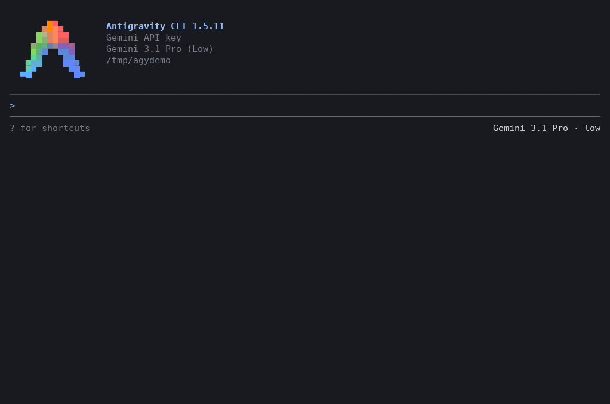

# TODO for AI for Antigravity

Ship the release in Antigravity, then hand off what comes after: the launch email, the X post,
tomorrow's signup check. Each handoff runs on [TODO for AI](https://todofor.ai), so you can close
Antigravity and check it later at its link.



## Install and sign in

```sh
agy plugin install https://github.com/todoforai/antigravity-plugin
```

In Antigravity, open `/plugin` → **todoforai** → **Sign in**. Open the URL it prints, sign in or
create an account on todofor.ai, and approve access. Paste the code from Google's page back into
the CLI. You should see `signed in to api.todofor.ai`.

The first time the assistant uses each TODO for AI tool, Antigravity asks you to allow it.

To update, run `agy plugin uninstall todoforai`, then repeat the install command above. You stay
signed in.

## Try it

- "Hand off a draft email to our beta users about this release. Don't send it."
- "Have TODO for AI check signup numbers tomorrow at 9 am my time."
- "Which of my handoffs need a reply?"

Or call the skills directly: `/todoforai-handoff`, `/todoforai-check`.

Before a handoff starts, the assistant shows you the prompt it will send and waits for your OK.
Check it for secrets: the assistant is told to leave them out, but nothing filters them automatically.

The TODO runs with your saved agent permissions, connected services and
[TODO for AI credit](https://todofor.ai/pricing). If it needs an approval or a sign-in, you do that
at the TODO's link. The plugin can't approve anything for you. For scheduled work, the first TODO
creates a second one, and that one's link has the result.

## Claude Code (experimental)

We haven't verified yet that Claude Code connects to TODO for AI.

```sh
claude plugin marketplace add todoforai/antigravity-plugin
claude plugin install todoforai@todoforai
```

Then authenticate **todoforai** in `/mcp`.

## Disconnect

`/plugin` → **todoforai** → **Sign out** signs out locally. `agy plugin uninstall todoforai` removes
the plugin. To have access revoked on our side too, email support@todofor.ai.

[Privacy](https://todofor.ai/legal/privacy-policy) · [Terms](https://todofor.ai/legal/terms-of-service)
